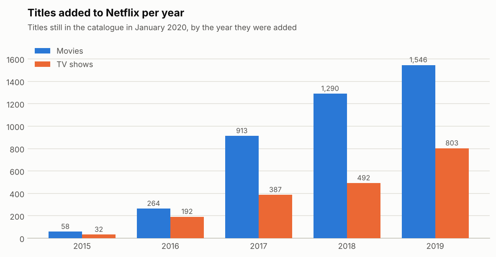
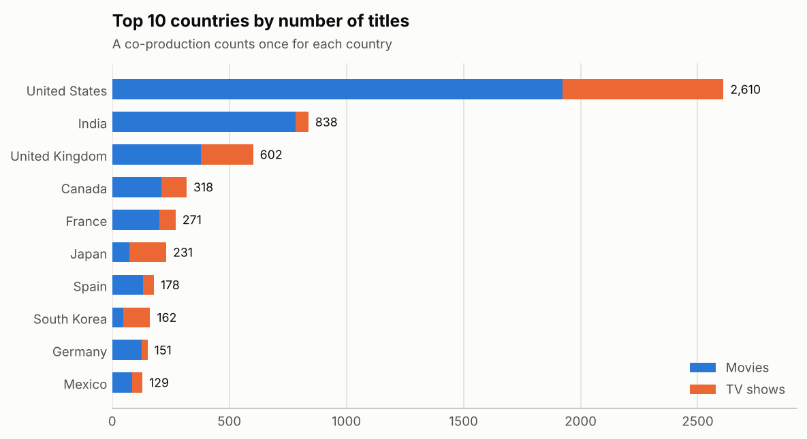
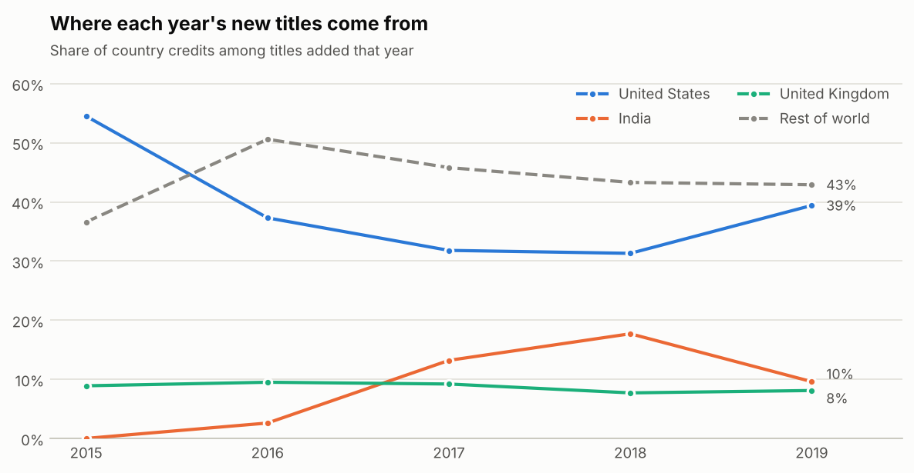
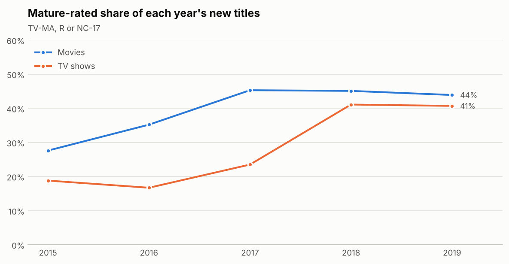
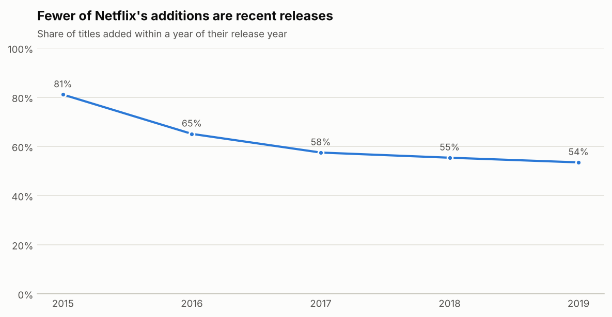

# Netflix Titles Analysis

What does Netflix's catalogue look like, and how did it change? I cleaned the public *Netflix Movies and TV Shows* dataset (6,234 titles on Netflix in January 2020) with Pandas, answered 15 questions with SQL, and built an interactive Streamlit dashboard.

**Live dashboard:** `https://YOUR-APP-NAME.streamlit.app`  <!-- replace after deploying, see "Deploy" below -->



## What I found

Every number comes from `results/sql_results.md` and `results/findings.json`, produced by the code in this repo.

| Question | Finding |
|---|---|
| **What is in the catalogue?** | 4,265 movies (68.4%) and 1,969 TV shows (31.6%) from 110 countries. |
| **How fast did it grow?** | Titles added per year went from 90 in 2015 to 456 in 2016, 1,300 in 2017, 1,782 in 2018 and 2,349 in 2019, about **5.2 times** the 2016 level in three years. TV shows were 42% of additions in 2016 and 34% in 2019. |
| **Where do titles come from?** | The **United States** has 2,610 titles (45% of titles with a country listed), then **India** with 838 (15%) and the **United Kingdom** with 602 (10.5%). India is almost all movies (783 of 838), while Japan and South Korea lean towards TV shows (156 of 231 and 116 of 162). |
| **Is that changing?** | The US share of new titles fell from 55% of country credits in 2015 to 31% in 2018, then rose to 39% in 2019. India went from 0% in 2015 to a peak of **18% in 2018**, then 10% in 2019. |
| **What genres dominate?** | International titles lead both movies (1,927) and TV (1,144), followed by drama and comedy. Crime is a TV genre (363 shows) and documentaries are mostly movies (668 vs 279). |
| **Who is it rated for?** | 44% of movies and 35% of TV shows are rated Mature (TV-MA, R, NC-17). Kids' ratings are 14% of TV shows but only 3% of movies. |
| **Is it getting more adult?** | The mature-rated share of each year's additions rose from **24% in 2015 to 44% in 2018** and 43% in 2019. |
| **How long are movies?** | The average 2010s movie runs 96 minutes against 112 for the 2000s. Part of that is 281 stand-up specials averaging 67 minutes. Without stand-up the gap remains: 98 vs 113 minutes. |
| **How many seasons do shows have?** | **67%** of TV shows have one season, and only 125 shows (6%) have five or more. |
| **Are additions newer or older?** | The share of titles added within a year of their release year fell from 81% (2015) to **54% (2019)**, so more of what Netflix adds is back catalogue. |
| **When are titles added?** | December (11.3%), October (10.4%) and November (10.2%) are the busiest months in 2016-19; February (6.3%) is the quietest. |

One data oddity: the five directors with the most titles (Jan Suter, Raúl Campos, Jay Karas, Marcus Raboy, Jay Chapman) are all stand-up specials, 61 titles in total, so "top directors" here mostly means comedy specials.

<p>
 
</p>
<p>
 
</p>

## How to read these results

- **This is a snapshot, not a history.** The data lists what was on Netflix in January 2020. A title added in 2016 and removed in 2018 is not in it, so earlier years look smaller than they were and the trends mix real change with survivorship. The *direction* of the 2016-2019 growth is clear, but the exact multiples are not.
- **Descriptive only.** The analysis shows what changed, not why. A growing international share fits Netflix expanding abroad, but this data cannot prove it.
- **2020 is excluded.** The file ends on 18 January 2020, so 2020 holds only 184 titles. Years before 2015 have fewer than 100 titles each, so most trends start in 2015.

## Data cleaning

`src/prepare_data.py` cleans the raw file and checks its assumptions:

- **Dates:** 640 `date_added` values had stray leading spaces; all dates are parsed into year and month. 11 titles have no date and are left out of yearly trends.
- **Duration:** movies are stored in minutes and TV shows in seasons, so I split the column into `duration_min` and `seasons`, and asserted that every movie has minutes and every show has seasons.
- **Multi-value columns:** country, genre and director hold comma-separated lists, so each is expanded into its own table (110 countries, 3,655 directors, 42 genre labels).
- **Genres:** 42 raw labels such as "Dramas" and "TV Dramas" are merged into 23 genre families.
- **Ratings:** 14 rating codes are grouped into Mature, Teen, Family, Kids and Unrated. 10 titles with no rating count as Unrated.
- **Missing data:** director is missing for 31.6% of titles, cast 9.1%, country 7.6%, and date added and rating 0.2% each. Nothing is filled in, and charts say how many titles are missing where it matters.
- **Checks:** `show_id` is unique. Three title-and-year pairs repeat ("Sarkar", "Tiger", "Kakegurui"). They have different `show_id`s, so all are kept; this file alone cannot show whether every pair is a distinct title. 9 titles were added in a year before their release year, which looks like a data entry quirk; they are kept.

## SQL

`sql/netflix_queries.sql` holds 15 queries: joins across four tables, CTEs, and the window functions `LAG`, `RANK`, `SUM() OVER` and `SUM() OVER (PARTITION BY ...)`, plus conditional aggregation and `UNION ALL`. They run in SQLite and every result is written to `results/sql_results.md`. Examples: year-on-year growth with `LAG`, catalogue size as a running total, top genres per type with `RANK`, and a missing-data table.

## Dashboard

`app.py` is a five-tab Streamlit app with a year-added filter: **Overview**, **Countries**, **Genres & ratings**, **Content** (movie length, seasons, freshness) and **Find a title** (filter by type, genre, country and rating, or search titles, cast, directors and descriptions).

## Run it yourself

```bash
pip install -r requirements-analysis.txt
# download netflix_titles.csv from Kaggle ("Netflix Movies and TV Shows") into data/raw/
python src/prepare_data.py     # clean -> data/processed/
python src/run_analysis.py     # SQL + figures -> results/, figures/
streamlit run app.py           # dashboard
```

The processed CSVs are committed, so `streamlit run app.py` works without the raw file.

## Deploy

1. Push this repo to GitHub.
2. Go to [share.streamlit.io](https://share.streamlit.io), sign in with GitHub, choose **Create app**, pick this repo, branch `main`, main file `app.py`.
3. Deploy, then paste the app URL into the "Live dashboard" line at the top of this README.

## Repo layout

```
app.py                     Streamlit dashboard
netflix_utils.py           genre and rating mappings, paths
netflix_charts.py          all charts (one colour system for README and dashboard)
src/prepare_data.py        raw -> clean tables + checks
src/run_analysis.py        SQL, headline numbers, figures
sql/netflix_queries.sql    the 15 SQL queries
data/processed/            cleaned tables (committed)
results/                   sql_results.md, findings.json
figures/                   charts used above
```

## Limitations and next steps

- One snapshot with no viewing data, so it says what Netflix offered, not what people watched.
- Genre and rating labels are Netflix's own and some overlap; the merged families are my judgement.
- A natural next step is joining ratings or popularity data from another source to see which kinds of titles do well.
